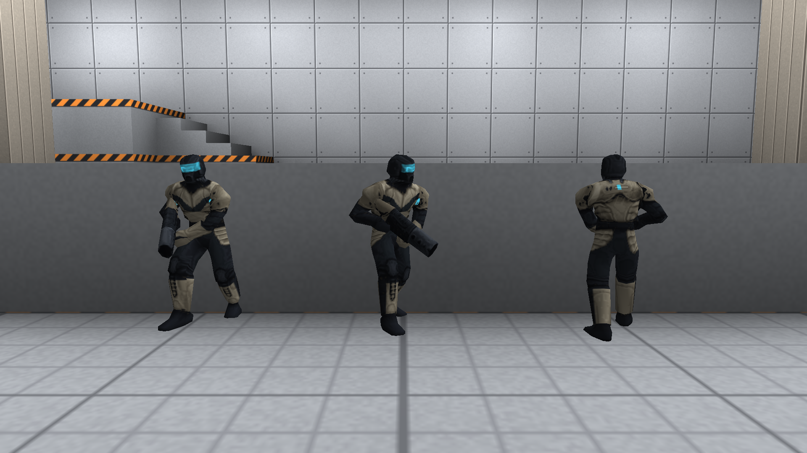
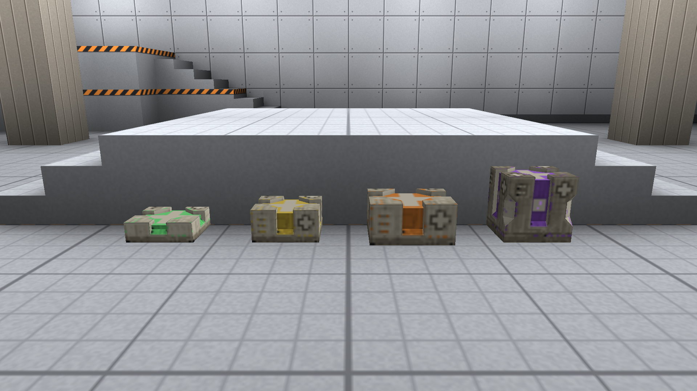
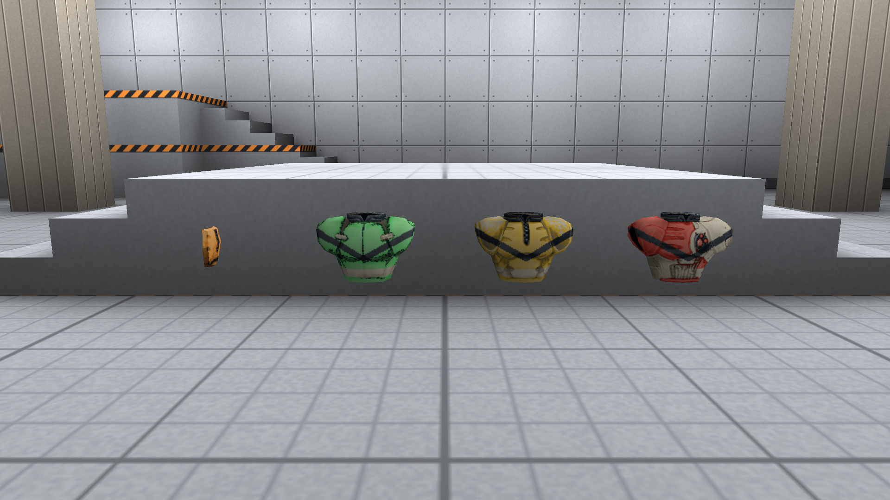
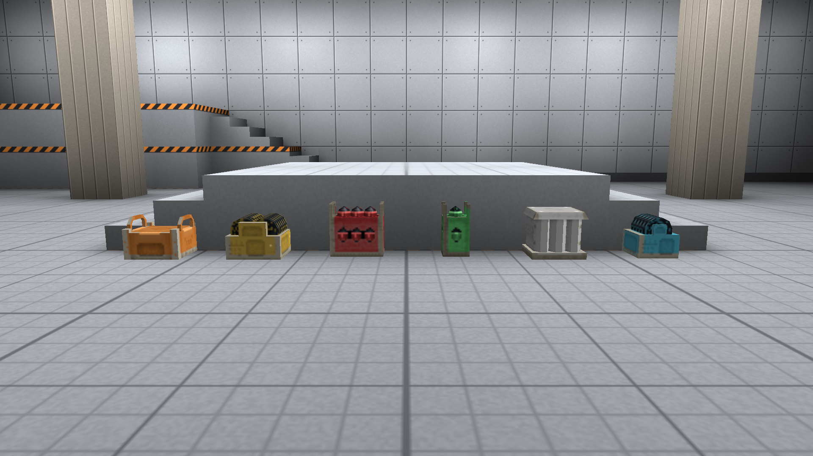
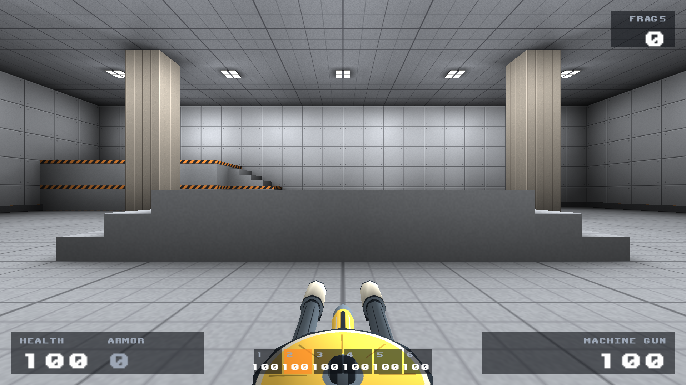
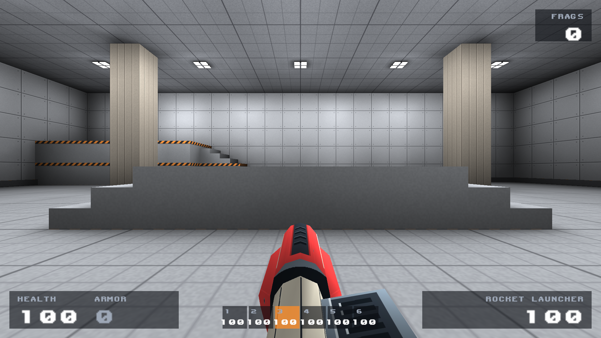
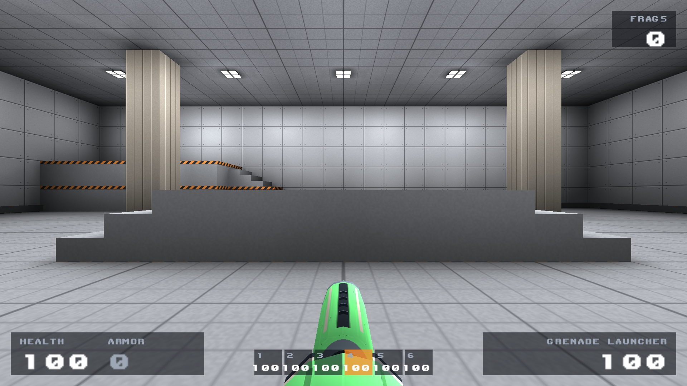
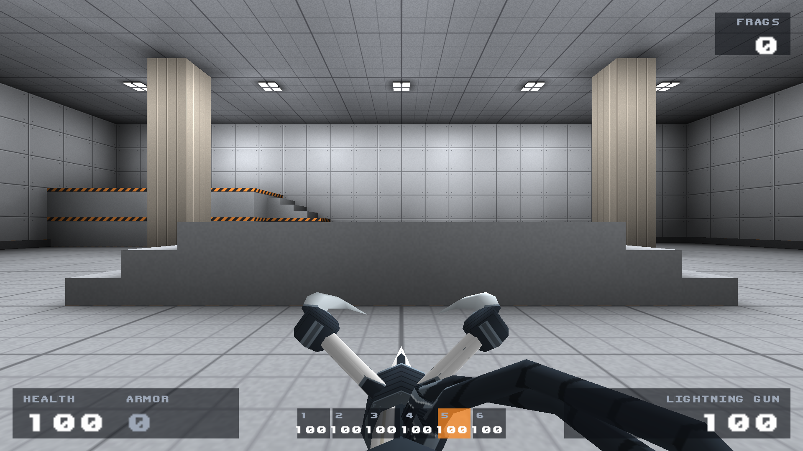
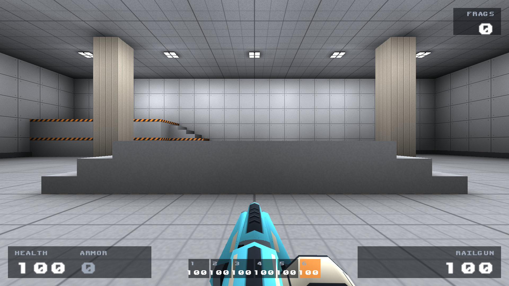

# Bone Circuit in-game captures

**Latest:** [full weapon set using the approved rocket finish](weapon-set/README.md).
The screenshots and showcase here have been refreshed. Numbered treatments in
the historical weapon-fix notes were rejected.

Captured directly from RAVAGE's OpenGL renderer on Apple M4, in the current
`duel_graybox` arena. These are actual model skins under the map's lighting.
The lineups are staged display entities; they are not a multiplayer match.
No generated images or software-rendered model previews are used here.

[Play the updated 32-second showcase](bone-circuit-ingame.mp4)

[Weapon material revision: before/after and 18-second firing video](weapon-fix/README.md)

| Video time | View |
|---|---|
| 0–4 s | Circuit player, rotating front/side/rear mannequins |
| 4–8 s | Health pickups |
| 8–12 s | Armour pickups and shard |
| 12–16 s | Ammo pickups |
| 16–20 s | World weapon pickups |
| 20–32 s | All six first-person weapons, two seconds each |

## Player



## Pickups






## First-person weapons








## Capture method

`tools/capture-skins.py` copies game data into an isolated ignored build folder,
refreshes its textures from `content/models`, and compiles capture-only server and
client game code. The fixture grants all weapons, places display entities in the
existing map, and hides the HUD/held gun for lineup shots. The gameplay source in
`game/` is unchanged. First-person shots show the game's HUD.

The video encodes real renderer screenshot frames at 15 fps, without interpolation,
to avoid the native raw-video encoder crashing on this macOS Retina configuration.
The PNG stills and video use the same actual engine, models and textures.
[Capture log](capture.log) records renderer initialization and screenshot output.

The compiled arena/game data started from successful main-branch CI run
[40135986396](https://github.com/chrislaupama/ravage/actions/runs/40135986396), with
local Bone Circuit textures and the capture-only game-code fixture overlaid.
The native client was built locally from this workspace; no engine changes were
needed. This verifies this capture configuration, not general macOS support.

Example, with existing compiled game data and an ffmpeg executable:

```sh
python3 tools/capture-skins.py \
  --client build-macos/bin/ravage \
  --qcc build-macos/bin/fteqcc \
  --game-data build/game \
  --ffmpeg /path/to/ffmpeg
```

Omit `--ffmpeg` to capture the eleven PNG screenshots only.
