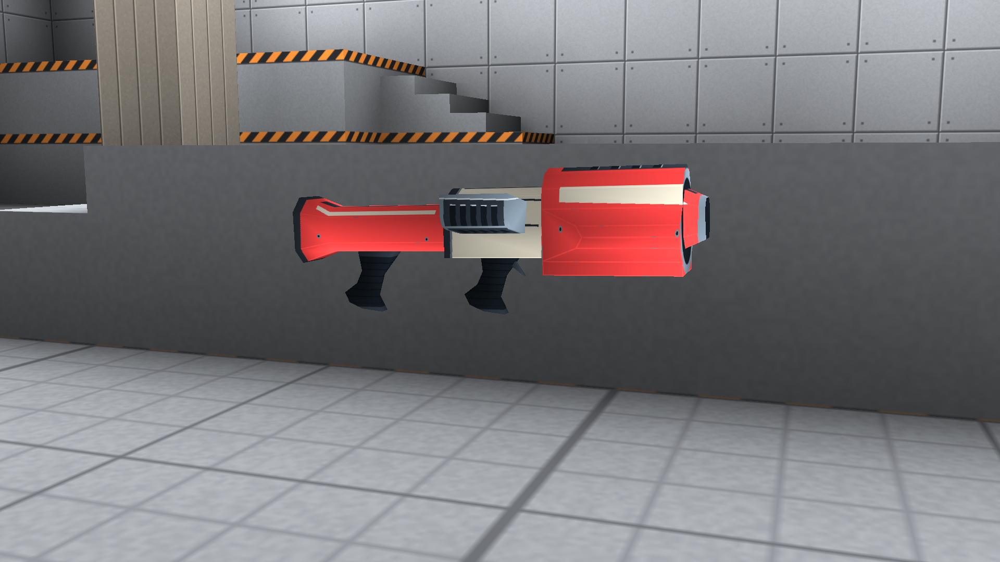
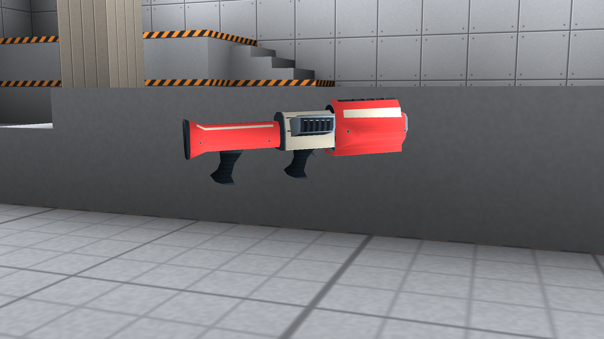

# Rocket launcher — approved reference

This reference was approved. Its finish is now applied across the
[full weapon set](../weapon-set/README.md). The captures here preserve the approved
reference. The previous numbered/plaque treatment was rejected.

[9-second actual-engine review](rocketlauncher-review.mp4)

## Normal first-person view


## Model inspection in the game renderer




The close views place the same first-person mesh at a neutral display origin in
the arena. They are staged inspection views, separate from the normal held pose
above. No generated paintover or software rasterizer is used in these images.
The clip shows the held pose and firing first, then the close inspection.

## Treatment

- No numbers, lettering, symbols, plaques or decorative light windows.
- Red cheek armour around a graphite cooling spine.
- Ivory coupling sleeve with dark longitudinal flutes and retaining collars.
- Steel muzzle lip, recessed heatsink and molded rubber grips.
- Soft contact shade and narrow wear confined to actual hard mesh edges.

Both the first-person and world rocket-launcher skins use this treatment. All
other runtime assets, meshes, UVs and animations remain unchanged from the prior
revision. Asset regeneration/reference checks pass. The view/world material maps
contain no ink or status-light IDs. These technical checks do not substitute for
visual approval.

Rebuild this candidate's authored maps:

```sh
python3 tools/assets/paint_weapon_materials.py --weapon rocketlauncher
python3 tools/assets/import_librequake.py --skins-only
```

Capture this review with a built client/compiler and compiled map:

```sh
python3 tools/capture-skins.py --weapon rocketlauncher \
  --client build-macos/bin/ravage --qcc build-macos/bin/fteqcc \
  --game-data build/game --output docs/art/bone-circuit/ingame/rocket-review \
  --ffmpeg /path/to/ffmpeg
```

[Renderer/capture log](capture.log). The game data/renderer provenance and existing
explosion-effect limitation are described in the [earlier capture notes](../README.md).
