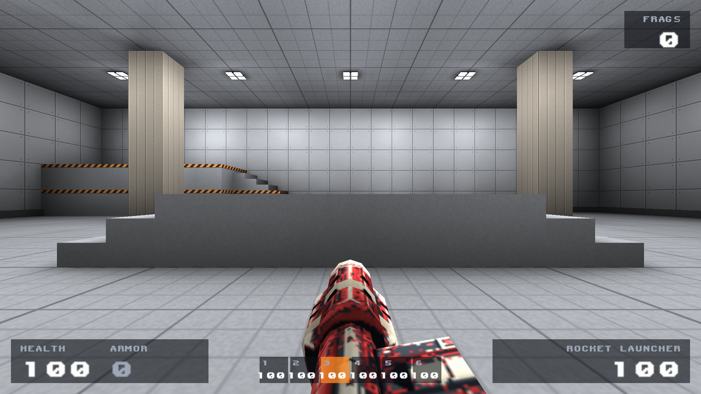

# First-person weapon material revision

**Superseded review:** the numbered/plaque treatment shown here was rejected.
See the [current rocket-launcher candidate](../rocket-review/README.md).

[18-second in-game idle/firing video](weapons-ingame.mp4)

The twelve weapon textures (six viewmodels, six world pickups) use clean
1024-pixel material maps aligned to physical mesh parts. Coloured housings,
ivory service inserts, graphite gaskets, rubber grips and steel barrels have
explicit boundaries. The old diffuse grain and full-object ivory wrap bands
have been removed. Small technical markings are oriented for the player's view.
Contact shading is baked from the geometry; broad paint does not emit light.

The mesh, UVs, animations and viewmodel transforms are unchanged. This revision
changes weapon skins only; player, health, armour, ammo and projectile textures
remain byte-identical to the earlier capture data.

## Same in-game camera

Rejected first pass:



Revised material map:


## All six first-person views

- [Shotgun](../shotgun.png), [firing pose](shotgun-fire.png)
- [Machine gun](../machinegun.png), [firing pose](machinegun-fire.png)
- [Rocket launcher](../rocketlauncher.png), [firing pose](rocketlauncher-fire.png)
- [Grenade launcher](../grenadelauncher.png), [firing pose](grenadelauncher-fire.png)
- [Lightning gun](../lightning.png), [firing pose](lightning-fire.png)
- [Railgun](../railgun.png), [firing pose](railgun-fire.png)

The 18-second video shows each gun for three seconds: idle, a short firing burst,
then recovery. It consists of actual engine frames at 15 fps, without generated
frames or interpolation. Stills are direct 1920 x 1080 engine screenshots.
[Firing capture log](firing-capture.log).

Asset generation and texture-reference checks pass. All twelve material maps
were checked for valid IDs and localized emission; all model, UV and animation
files remain byte-identical. In-game inspection covered all six idle and firing
views. These checks establish the implemented result; visual approval remains
with the user. The existing game reports a missing legacy explosion sprite when
rockets explode; the weapon texture revision does not change explosion effects.

To regenerate the firing review, with a built client/compiler and compiled map:

```sh
python3 tools/capture-skins.py --weapons-only \
  --client build-macos/bin/ravage --qcc build-macos/bin/fteqcc \
  --game-data build/game --output build/weapon-review \
  --ffmpeg /path/to/ffmpeg
```
