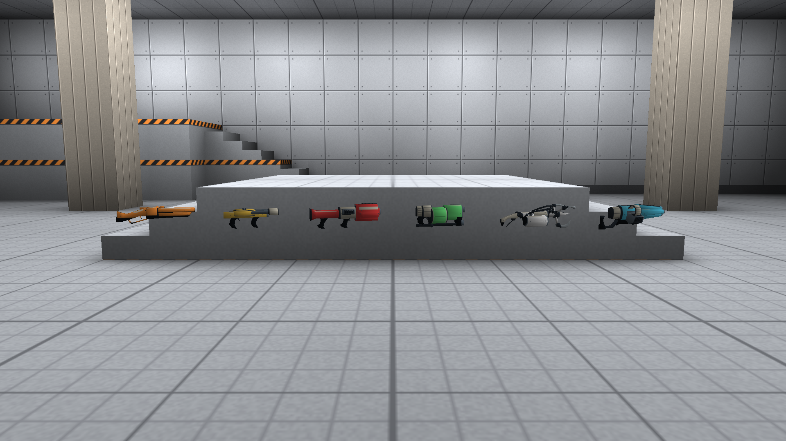
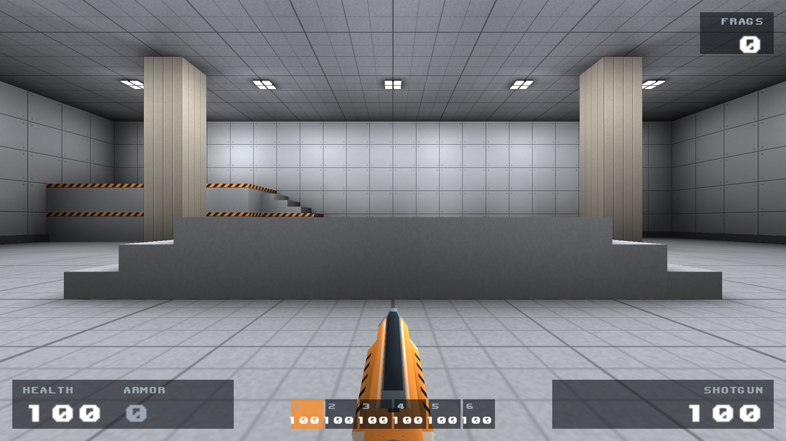
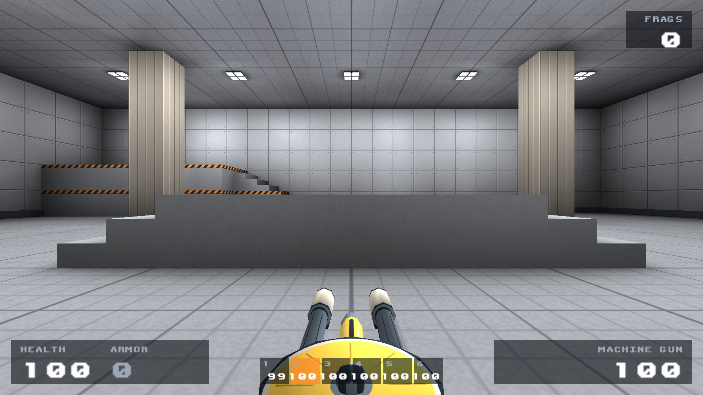
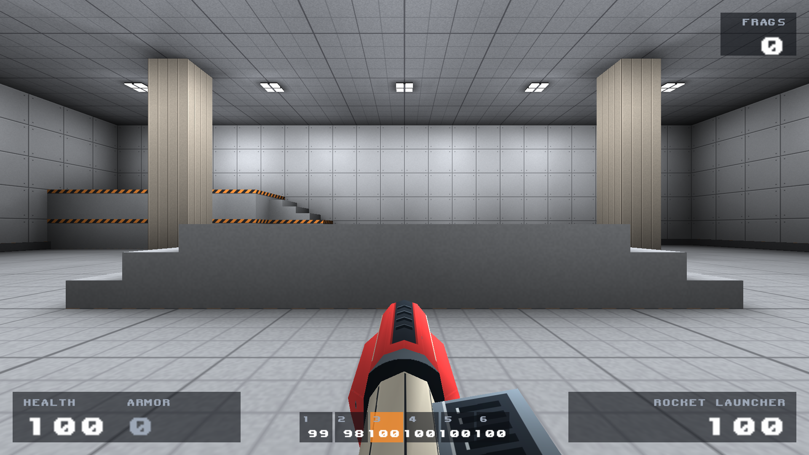
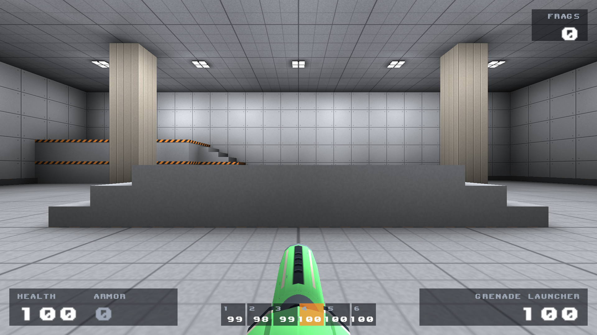
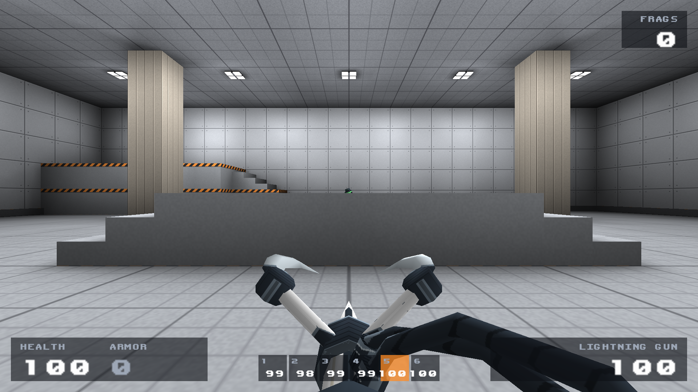
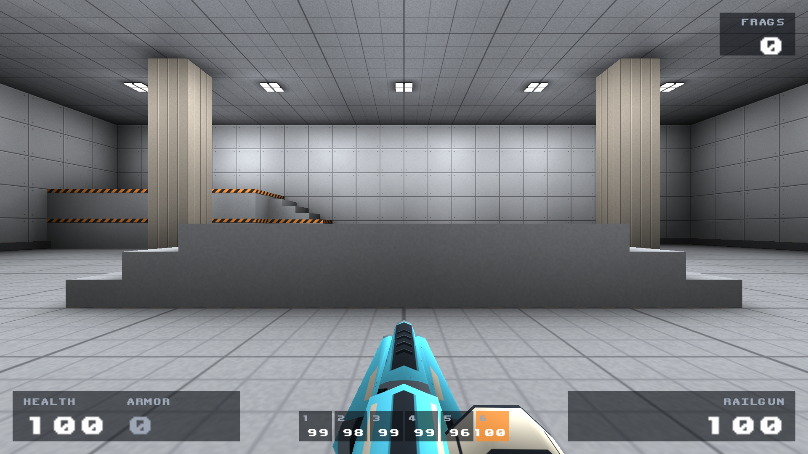

# Bone Circuit weapon set

The approved rocket-launcher finish has been applied to the other five weapons,
including their world pickups. The rocket launcher's textures are byte-identical
to the approved reference. There are no numbers, lettering, plaques, symbols or
decorative light windows on the weapon skins.

[18-second actual in-game idle/firing video](weapons-ingame.mp4)

| Weapon | Identity | Part treatment |
|---|---|---|
| [Shotgun](shotgun.png) | Orange | Ribbed moving pump, dark sight rail, ivory coupling |
| [Machine gun](machinegun.png) | Amber yellow | Enclosed feed drum, steel spindle/barrels, ivory muzzle sleeves |
| [Rocket launcher](rocketlauncher.png) | Red | Approved cheek shells, cooling spine, fluted coupling and steel heatsink |
| [Grenade launcher](grenadelauncher.png) | Green | Recessed revolver chamber, retaining collars and ventilated receiver |
| [Lightning](lightning.png) | White | Insulated leads/collars, white arms and steel electrode tips |
| [Railgun](railgun.png) | Cyan | Ventilated rail housing, ceramic power block and steel heatsink |

All share the approved ivory couplings, graphite mechanisms, molded grips, soft
contact shade and narrow wear on actual hard mesh edges. Their distinctive
geometry and palette remain intact. No generic text panels or invented badges
were added.

## World pickups

[World capture log](world-capture.log).

## In-game views

## Firing checks

Each gun appears for three seconds in the video, with idle, a short firing burst,
and recovery. All frames come directly from the actual game renderer at 1080p,
encoded at 15 fps without interpolation. No generated paintovers are used.

[Firing capture log](capture.log).

- [Shotgun firing](shotgun-fire.png)
- [Machine gun firing](machinegun-fire.png)
- [Rocket launcher firing](rocketlauncher-fire.png)
- [Grenade launcher firing](grenadelauncher-fire.png)
- [Lightning firing](lightning-fire.png)
- [Railgun firing](railgun-fire.png)

Asset regeneration and model/skin-reference checks pass. All twelve material maps
were checked for no ink/status-light IDs and emission confined to muzzle-flash
UVs. The approved rocket, player, pickups, projectiles, meshes and animations are
unchanged. The existing missing explosion-sprite limitation is recorded in the
earlier capture notes; it is separate from these weapon surfaces.

[Full-set arena capture](../README.md) includes world weapon pickups.
[Approved rocket reference](../rocket-review/README.md).
