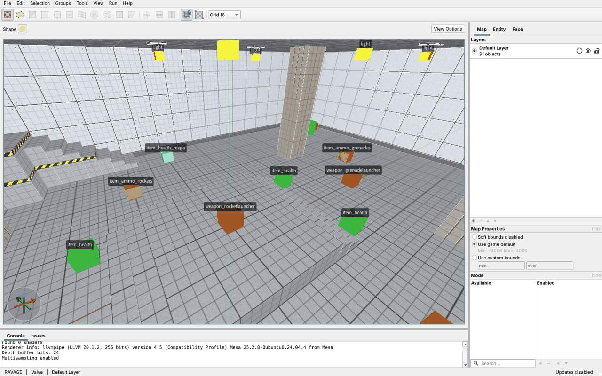
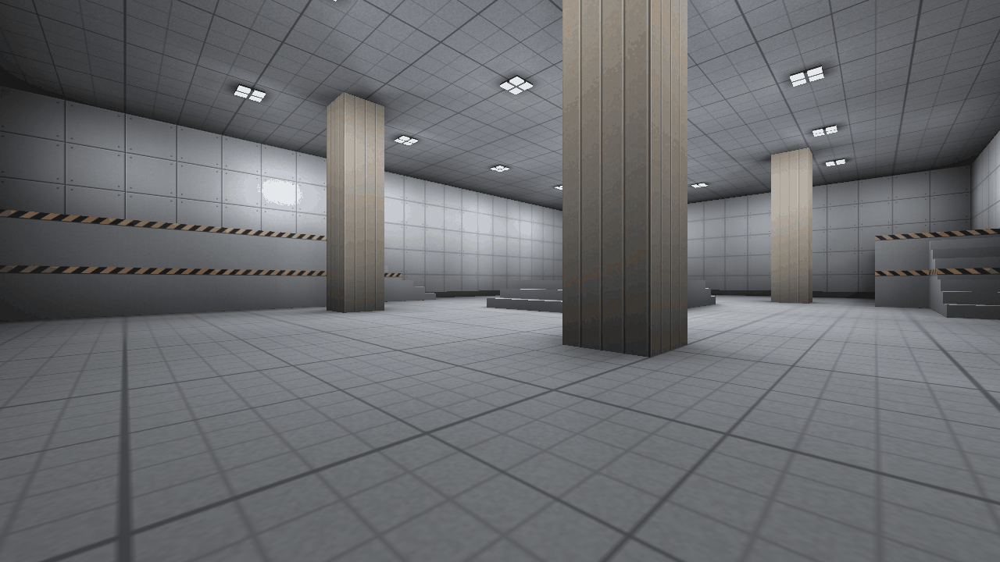
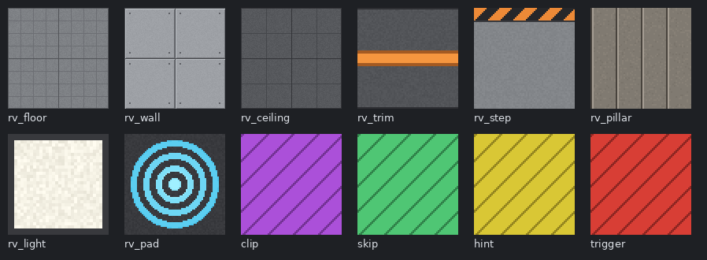

# Making maps

RAVAGE maps are made in [TrenchBroom](https://trenchbroom.github.io/) and compiled with [ericw-tools](https://github.com/ericwa/ericw-tools) to Quake BSP2. Maps can be saved in Valve 220 format (the default) or standard Quake format.



## What's in the repository

| Path | What it is |
|---|---|
| `tools/trenchbroom/RAVAGE/` | TrenchBroom game config (`GameConfig.cfg`), entity definitions (`ravage.fgd`), compile profile and icon |
| `content/maps/*.map` | Map sources. `duel_graybox.map` is the first graybox Duel arena. |
| `content/textures/ravage.wad` | Graybox textures (WAD3), made by `tools/textures/make_textures.py` |
| `content/gfx/palette.lmp` | The RAVAGE palette, made by the same script |
| `game/ssqc/` | Server game code, including a spawn function for every entity in the FGD |
| `tools/fetch-ericw-tools.sh` | Downloads the pinned ericw-tools release (v0.18.1) into `deps/ericw-tools/` |
| `tools/build-game-data.sh` | Compiles the game code and every map into `build/game/base/` |
| `tools/bench-map.sh` | Rendering benchmark for a map |

## One-time setup

1. Build the engine (see [building.md](building.md)), then fetch the map tools and build the game data:

   ```
   tools/fetch-ericw-tools.sh
   cmake --build build --target game-data
   ```

2. Install TrenchBroom. The config uses TrenchBroom's version 9 game config format and was tested with TrenchBroom 2026.2.
3. Copy the `tools/trenchbroom/RAVAGE` folder into TrenchBroom's user games folder:
   - Linux: `~/.TrenchBroom/games/`
   - Windows: `%APPDATA%\TrenchBroom\games\`
   - macOS: `~/Library/Application Support/TrenchBroom/games/`
4. In TrenchBroom, open Preferences, pick RAVAGE, and set:
   - **Game path**: the repository's `build/game` folder.
   - **Compilation tools**: `qbsp`, `vis` and `light` from `deps/ericw-tools/bin`.
5. Optional, for Run > Launch Engine: add `build/bin/ravage` (or `ravage.exe`) with the parameters `-basedir ${GAME_DIR_PATH} +map ${MAP_BASE_NAME}`.

## Working on a map

Open a map from `content/maps`. Textures load from the `wad` key on the world entity, which is `../textures/ravage.wad`, relative to the map file.

To test a change, either:

- run the **RAVAGE BSP2** profile from Run > Compile Map. It compiles next to the map and copies the BSP into `build/game/base/maps`. The compilers' side files (`.prt`, `.log`, `-compile.map`) are ignored by git; or
- run `tools/build-game-data.sh`, which compiles every map in a scratch folder.

Then play it with `build/bin/ravage -basedir build/game +map <name>`.



### Rules for maps

- Use RAVAGE textures and entities only. Never use Quake textures, models or maps, even as a temporary placeholder in a committed file. See [licensing.md](licensing.md).
- Every map must be sealed (no leaks). The compile uses `-leaktest`, so a leak fails the build.
- Put at least two `info_player_deathmatch` spawn points in a Duel map.
- Place pickups with their bounding box resting on the floor, and spawn points with the bottom of the player box on the floor. The map test checks both.

## Entities

`ravage.fgd` defines everything the editor can place. Pickups have no models yet and show as coloured boxes.

| Group | Classes |
|---|---|
| Spawns and markers | `info_player_deathmatch`, `info_player_start` (fallback), `info_intermission`, `info_teleport_destination`, `target_position` |
| Weapons | `weapon_shotgun`, `weapon_machinegun`, `weapon_rocketlauncher`, `weapon_grenadelauncher`, `weapon_lightning`, `weapon_railgun` |
| Ammunition | `item_ammo_shells`, `item_ammo_bullets`, `item_ammo_rockets`, `item_ammo_grenades`, `item_ammo_cells`, `item_ammo_slugs` |
| Health | `item_health_small`, `item_health`, `item_health_large`, `item_health_mega` |
| Armor | `item_armor_shard`, `item_armor_light`, `item_armor_medium`, `item_armor_heavy` |
| Triggers | `trigger_push` (jump pad), `trigger_teleport` |
| Lighting | `light` (compiler only) |
| Brush entities | `func_detail`, `func_wall`, `func_illusionary`, `func_group` |

The names follow the weapon archetypes in the [vision](vision.md#42-precision-combat) and will change once weapons get their final names. Picking things up, jump pads and teleporters all work, and every pickup has a placeholder model in the game.

## Textures and palette

The engine draws BSP textures with 8-bit colour, using `gfx/palette.lmp`. RAVAGE has its own palette, made of colour ramps (grays, warm gray, orange, cyan, and tool colours). The last 32 colours are fullbright, so they glow regardless of lighting: the light panels and the trim stripe use them.

To change or add textures, edit `TEXTURES` in `tools/textures/make_textures.py` and run it. It rewrites both the WAD and the palette, and the output is the same every time it runs. The tool textures `clip`, `skip`, `hint` and `trigger` are never drawn in game.



## Compiling by hand

`tools/build-game-data.sh` runs, for each map:

```
qbsp -bsp2 -leaktest -wadpath content/maps <map>.map
vis <map>.bsp
light -bounce -extra4 <map>.bsp
```

## Tests

`tests/map_pipeline.sh` (run by `ctest`) checks that every FGD entity has a spawn function, compiles all maps, checks each is BSP2, then loads each on the dedicated server. A self-test in the game code (`game/ssqc/selftest.qc`) checks that every spawn point has room for a player and a floor under it, and that every pickup rests on a floor and has a model. On Windows CI the same test runs with the Windows builds of the engine and ericw-tools.

## Benchmark

`tools/bench-map.sh [map] [frames] [width] [height]` loads a map in the client and turns the view a full circle from the first spawn point, three times with each of two measurements, printing the frame rate:

- `timerefresh` times the engine drawing the 3D view alone.
- `framebench` (the game's `rv_framebench` command) times whole frames, including the HUD, the first-person weapon and the client game code.

Compare before and after renderer, map or HUD changes, over several runs.

The Linux CI job runs it on every pull request with software rendering (Xvfb and Mesa llvmpipe) at 1280x720 and prints the results in the job log. Software rendering is CPU-bound, so the numbers aren't what a graphics card would give, but they are consistent enough to spot regressions. For reference, `duel_graybox` on a 4-core cloud machine gave about 180 fps at 640x480, 75 at 1280x720 and 36 at 1920x1080 with `timerefresh`, and about 70 fps at 1280x720 with `framebench`.
