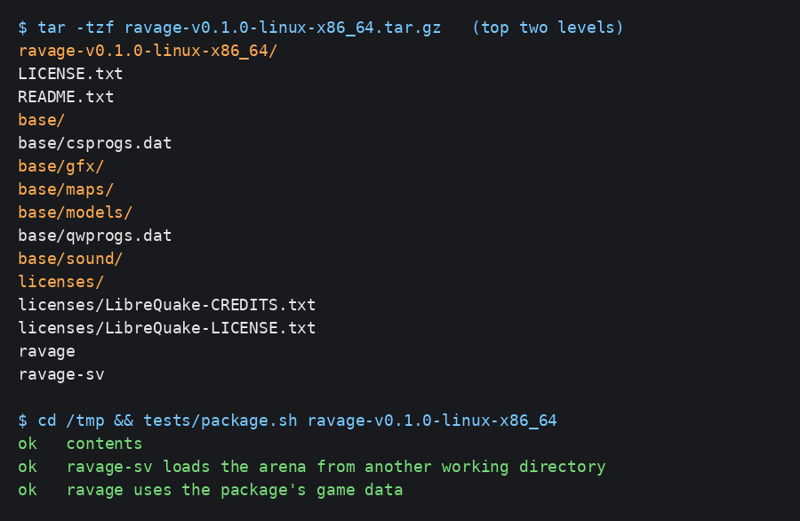
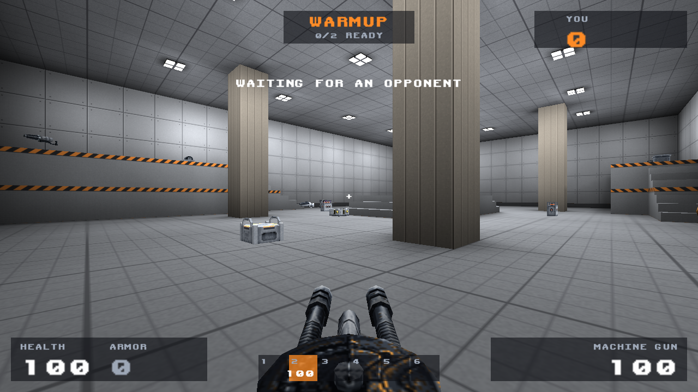

# Releasing RAVAGE

Every release on GitHub gets standalone packages for Linux, Windows and macOS, built by `.github/workflows/release.yml`.

## Making a release

Push a version tag:

```
git tag v0.1.0
git push origin v0.1.0
```

Or, on GitHub, draft a new release with a new `v...` tag and publish it. Either way the workflow builds the three packages, tests each one on its own operating system, and attaches them to the release with a `SHA256SUMS.txt` file. For a pushed tag it creates the release first, with notes generated from the merged pull requests. A tag with a hyphen, such as `v0.2.0-beta.1`, is marked as a pre-release.

To try the packages without releasing, run the workflow by hand from the Actions tab (Run workflow) and download them from the run's artifacts. Pull requests that change the packaging run it too.

## What's in a package

| Package | Contents |
|---|---|
| `ravage-<version>-linux-x86_64.tar.gz` | `ravage`, `ravage-sv` and `base/`. Needs glibc 2.35 or later (Ubuntu 22.04, Debian 12, Fedora 36, SteamOS 3 or newer). The game uses the system's SDL2, OpenGL, libpng and fontconfig; the server needs only zlib. CI checks the programs link nothing else. |
| `ravage-<version>-windows-x86_64.zip` | `ravage.exe`, `ravage-sv.exe` and `base/`. Windows 10 or later; needs no extra DLLs. |
| `ravage-<version>-macos-universal.zip` | `RAVAGE.app` (Apple silicon and Intel, macOS 11 or later) with the server and game data inside, and a `ravage-sv` link to the server. |



Each one also holds:

- `README.txt`: how to run the game and server, and the credits.
- `LICENSE.txt`: the GPL, which covers the engine. The README links the source for the release's tag.
- `licenses/`: LibreQuake's BSD license and contributor list, which must travel with its models and sounds (see [licensing.md](licensing.md#librequake)), and the license of every library built into that package (zlib, libpng and FreeType on Windows; SDL2, libpng, FreeType and epoll-shim on macOS).

Packages never contain Quake assets, the QuakeC compiler or the map tools. `tests/package.sh` checks each package for the license files and for Quake files, and checks that the server loads `duel_graybox` and the client finds the package's game data when started from another folder. It also runs under `ctest` with a Linux package built from `build/`.

The programs look for `base/` in the working directory first, then next to the executable (inside a macOS app, in `Contents/Resources`). So a package runs from a shortcut, from Finder or from any terminal folder, and `-basedir` still overrides both.



## macOS signing

The app has an ad-hoc signature, which Apple silicon needs to run it but which isn't tied to any developer identity. It isn't notarized, so macOS blocks it on first launch until the player chooses Open Anyway in System Settings > Privacy & Security, as the README explains. Signing with a Developer ID and notarizing would remove that step, but RAVAGE doesn't do it for now: it would put a personal Apple developer identity on every build and its certificate into CI.

## Building a package locally

After building the programs and the game data (see [building.md](building.md)):

```
tools/package-release.sh linux-x86_64 v0.1.0 build/bin build/game dist
tests/package.sh dist/ravage-v0.1.0-linux-x86_64
```

Windows packages need the dependency prefix as a sixth argument (`deps/win64`) for its license files. macOS packages must be built on a Mac, with the libraries from `tools/build-macos-deps.sh`; the workflow's `macos` job shows the CMake options.
